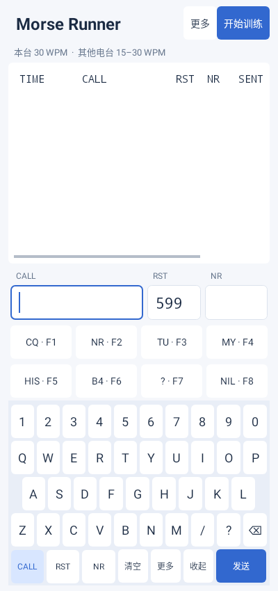
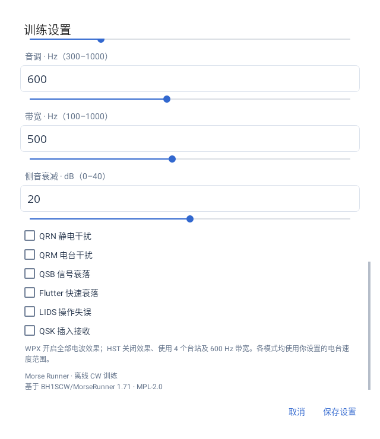

# Morse Runner Android

面向 Android 手机和平板的离线 CW 通联训练器。

**当前版本：0.1.9** · Android 8.0 及以上 · ARM64（arm64-v8a）

[下载最新版本](https://github.com/LingxiangXinggu/MorseRunnerAndroid/releases/latest) · [报告问题](https://github.com/LingxiangXinggu/MorseRunnerAndroid/issues) · [MPL-2.0 许可证](LICENSE)

## 功能

- **四种模式**：Pile-Up 多台呼叫、Single Calls 单台练习、WPX 和 HST 竞赛训练。
- **触屏与外接键盘**：可选系统键盘或内置 QWERTY 键盘，RST／NR 自动切换数字布局；支持蓝牙、USB 和磁吸键盘。
- **自适应布局**：浅色界面，手机窄屏快捷键两行排列，平板宽屏一行排列，适应旋转和分屏。
- **独立速度设置**：本台 10–120 WPM，其他电台 5–120 WPM；上下限相同可固定对方速度。
- **电波效果**：QRN、QRM、QSB、Flutter、LIDS 和 QSK。QSK 默认关闭，可在高级设置中开启。
- **便捷调节**：速度、时长、活跃度、音调、带宽和侧音衰减均支持手动输入与滑块联动。
- **呼号库**：内置 WPX、WAPC 和原库，支持导入 SCP 文本库与国家信息查询。
- **通联记录**：Raw／Verified 计分、重复及交换号检查、最新记录自动滚动、CSV 导出。
- **本地运行**：训练无需联网，偏好和最近一轮记录保存在设备中。

## 界面预览

以下为测试环境渲染预览。

 

## 安装与使用

1. 在 [Releases](https://github.com/LingxiangXinggu/MorseRunnerAndroid/releases) 下载 ARM64 release APK 并安装。
2. 首次启动配置本台呼号、速度、模式、呼号库和输入键盘。
3. 点击“开始训练”。Pile-Up／WPX 下按 F1 或在空呼号时按 Enter 发 CQ；Single Calls／HST 自动产生呼叫台站。
4. 抄入对方呼号后按 Enter 发送呼号和交换号；填入 NR 后再按 Enter 发 TU 并记录。
5. 在“更多 → 训练设置”调整偏好，在“更多 → 导出 CSV”保存通联记录。

内置键盘支持 CALL／RST／NR 切换、选区替换、退格、长按退格清空字段、清空整条输入和发送。选择内置键盘后，训练区不自动弹出系统输入法，设置页仍使用系统键盘。系统输入法接收英文／ASCII 提示，具体布局取决于输入法实现。

F1–F8 对应屏幕宏键，Enter 执行 ESM，Esc 停发，PgUp／PgDn 调整本台 WPM。切到后台或丢失音频焦点会停止训练并保存记录；打开 CSV 文件选择器同样会触发后台停止。

## 构建

| 工具 | 版本 |
| --- | --- |
| JDK | 17 |
| Gradle | 8.11.1 |
| Android Gradle Plugin | 8.9.2 |
| SDK Platform / Build Tools | 35 / 35.0.0 |
| NDK | 28.0.13004108 |
| CMake | 3.22.1 |

安装工具链并设置 `JAVA_HOME`、`ANDROID_HOME` 后：

```bash
bash scripts/test-core.sh
bash scripts/test-java.sh
bash scripts/build-android.sh
```

debug APK：`app/build/outputs/apk/debug/app-debug.apk`。构建脚本自动下载并校验固定版本 Gradle。

GitHub Actions 的 [Android ARM64](https://github.com/LingxiangXinggu/MorseRunnerAndroid/actions) 工作流会测试核心并生成 debug APK。它使用 debug 签名；安装已发布版本的设备应使用 Releases 中相同发布签名的更新包。

发布构建与签名配置见 [SIGNING.md](docs/SIGNING.md)。

## 测试

```bash
bash scripts/test-core.sh
bash scripts/test-java.sh
bash scripts/test-jni.sh
```

Android Studio 或 Gradle 的 `:app:testDebugUnitTest` 任务运行 Robolectric 界面测试。测试覆盖通联状态机、计分、音频边界、呼号数据、速度范围、输入键盘、设置联动及自适应布局。主机测试不能替代实际设备的音频延迟、输入法和窗口行为验证。

## 来源与版本

**0.1.9 是 Android 应用版本；1.71 是原版 Morse Runner 的算法基线。**

核心基于 [BH1SCW/MorseRunner](https://github.com/BH1SCW/MorseRunner) 的固定提交 `f5e96d3a08b1d60890975b345acdcf32aac37883` 移植，使用 C++ 引擎和原生 Android 界面。模块对应与平台差异见 [PORTING.md](docs/PORTING.md)，图标来源见 [ICON.md](docs/ICON.md)。

内置库包含 WPX 50,263、WAPC 585、原库 59,942 条呼号；原始校验值记录在 [DATA_MANIFEST.json](docs/DATA_MANIFEST.json)。WAPC 是候选呼号库名称，不表示实现 WAPC 竞赛计分规则。数据文件的来源与权利归属独立于移植代码许可。

## 贡献者与致谢

- **BI6PPC / [LingxiangXinggu](https://github.com/LingxiangXinggu)**：Android 项目维护、功能设计与设备测试。
- **Alex Shovkoplyas / VE3NEA**：原版 Morse Runner 作者。
- **BG4FQD、BH1SCW**：上游项目贡献。
- **Codex（OpenAI）**：开发协作工具，协助 Android 移植、界面实现、调试、测试、构建与文档整理。

欢迎通过 Issues 提交设备型号、系统版本、复现步骤和问题描述，或通过 Pull Request 贡献改进。

## 许可

移植代码采用 [Mozilla Public License 2.0](LICENSE)。保留上游源码中的原有版权和许可声明。
